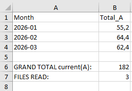

# Εxcel Monthly Report

Reads .xlsx files from the data folder, sums current (A) values per file and overall, and exports a summary report with a bar chart to summary.xlsx.
# What it does
- Checks if the data folder exists and contains Excel files.
- Reads .xlsx files inside the data directory.
- Warns if any file is open in Excel.
- Skips temporary Excel files (~$) and empty cells.
- Calculates the total current per month and the grand total. 
- Prints the monthly totals, the grand total and the number of files read in Terminal.
- Adds a bar chart of the total current per month to the report.
- Creates monthly report summary.xlsx in the current working directory.
- Accepts current values written with a comma or a dot (e.g. 38,5 or 38.5).
 
# Example output



# How to run

1. Install openpyxl:
```
pip install openpyxl
```
2. Put the `data` folder in the same folder as the script, then run:
```
python excel_monthly_report.py
```
The report is saved as `summary.xlsx`
# Skills shown
openpyxl, loops, data cleaning, Excel automation, pathlib, nested loops, working with multiple files, input validation, error handling, charts with openpyxl.  

# Author
Michalis Malatras, Electrical Engineer, learning Python for industrial automation
